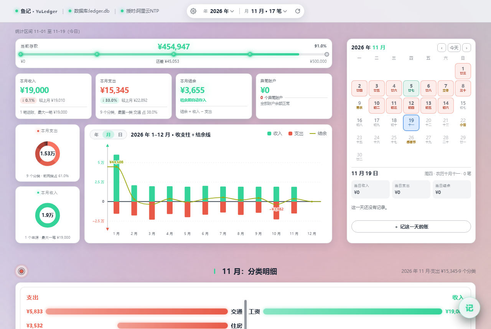
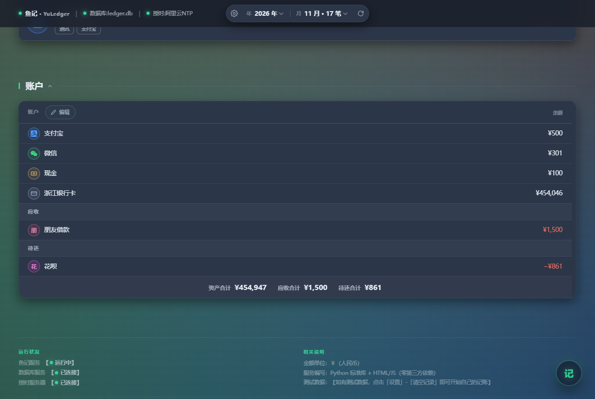
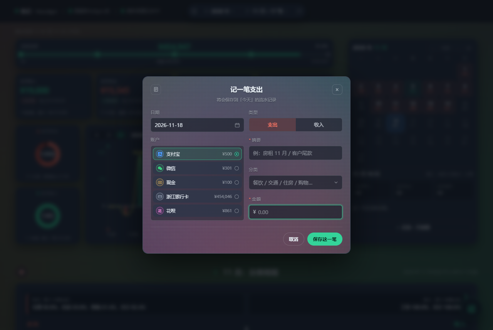
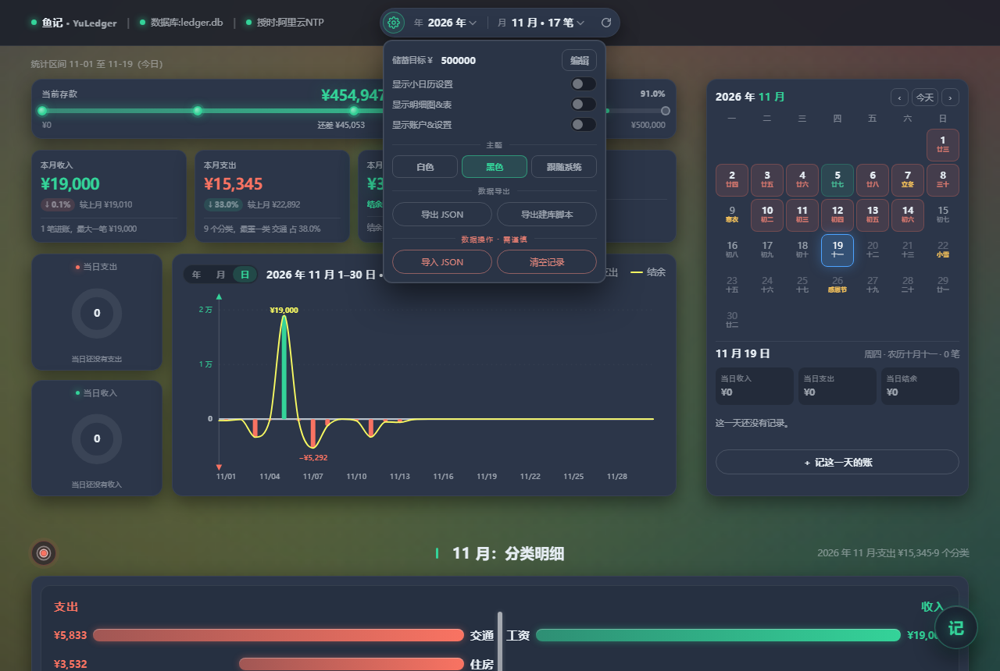
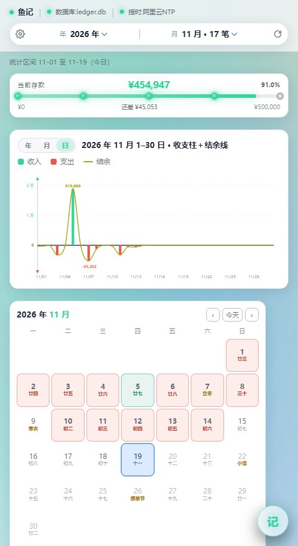

# 鱼记 · YuLedger

> **写在前面**：主要借助 WorkBuddy 调用 hy4 编写，部分绘图与交互细节用 AI 辅助完成。
>
> 累计投入约 12 小时、前后跨 3 天左右（每天抽空做一点），细节上可能还有不少瑕疵。最初只是想手记一下这个月的付账明细，脑子里也没什么思路，就按「AI 出板 → 改 → 画 → 用 → 改」反复调整；暂时先这样，以后可能再改。

一个**运行时零第三方依赖**的本地记账看板：Python 标准库起 HTTP 服务，单文件 `index.html` 做界面，数据全部落在 SQLite `ledger.db`。

- 电脑上双击启动，浏览器打开即用；同一 WiFi 下的手机也能访问
- 断网也能记账（授时会自动回退到本地时间，跟随系统的主题也按本地时间判定）
- 数据只存 `ledger.db`，删掉浏览器缓存、换浏览器都不影响；数据库文件丢了页面会变只读并提示恢复
- 深浅两套主题都带**多色流动渐变背景**，用低分辨率 canvas 绘制，静止与交互均保持 60fps，且文字对比度始终高于 WCAG 4.5

## 关于名字

| 项目 | 内容 |
| --- | --- |
| 中文名 | **鱼记** |
| 名字寓意 | 鱼记承余韵，年年有富余 |
| 英文名 | **YuLedger** |
| 读音 | `/juˈledʒər/`，意思「你的账本」 |
| 图标 | 「鱼」与「￥」的结合，取「年年有余」之意；青绿圆角方块底 + 白色鱼形，鱼身内含 `¥`，无多余装饰圈 |
| 界面显示名 | 顶栏「鱼记 · YuLedger」（窄屏只留「鱼记」）；Android 桌面图标名「鱼记」 |

浏览器标签名固定为「鱼记·YuLedger」；这句寓意会在启动时展示，加载完成后收回页脚。启动画面使用**圆形**的同款徽章，加载结束时它会沿弧线跳到浮动「记」按钮的位置并落下一圈涟漪——落点按按钮的实际屏幕坐标实时计算，所以按钮被拖到左上 / 右上 / 左下 / 右下任一角都能对上。

源码与发行版：<https://gitee.com/c-s-y/yuledger>，采用 MIT License。

Android 发行包自 1.0.7 起按 **`YuLedger-<版本>-<abi>.apk`** 命名：默认包 `YuLedger-1.1.1-arm64-v8a.apk`（覆盖绝大多数真机），另有 `YuLedger-1.1.1-universal.apk`（含 arm64-v8a / armeabi-v7a / x86_64 / x86 四种架构，覆盖 32 位老机与模拟器）。YuLedger 读作 `/juˈledʒər/`，就是「你的账本」。**1.0.8 起 Android 包名由 `cn.etsdash.app` 改为 `cn.yuledger.app`、签名别名改为 `yuledger`（证书指纹不变）**：新旧包会作为两个独立应用并存，首次启动新版会自动从旧包名的外部目录迁移 `ledger.db`；确认账本无误后可自行卸载旧版。`ledger.db` 文件名与桌面端数据目录保持不变。

## 截图

桌面 · 首屏（浅色主题）：



账户区 · 表头与合计固定、只滚明细（深色主题）：



记一笔 · 桌面弹窗与流动渐变背景（深色主题）：



账本设置浮窗：



手机 · 首屏（浅色主题）：



> 截图使用**虚构演示数据**（演示账本 1389 笔流水），浅色 / 深色分别对应「白色」「黑色」主题档。背景颜色会持续缓慢流动，每次打开都不完全相同。桌面首屏把收支柱图切到「月」粒度、环形图随之显示当月汇总；设备端「显示收支卡片」开关默认关闭，故手机首屏不显示四张卡片与环形图（桌面端无此开关、始终显示）。

## 快速开始

### Windows

```bat
start.ps1         :: PowerShell 5.1（右键「使用 PowerShell 运行」）
start7.ps1        :: 已装 PowerShell 7 时用这个
start.bat         :: 老式 cmd 启动
```

首次运行若提示脚本被策略拦截：

```powershell
Set-ExecutionPolicy -Scope CurrentUser RemoteSigned
```

Windows 控制台会把启动信息与最近 **10 行运行日志**固定在窗口内原地刷新，不会把上方的配置说明顶掉。

### Linux / NAS（Debian、ARM 均可）

```sh
chmod +x start.sh
./start.sh            # 前台运行，Ctrl+C 停止
./start.sh daemon     # 后台运行，日志在 ~/.local/state/ledger/server.log
./start.sh status     # 查看状态
./start.sh stop       # 停止
```

### 直接跑

```sh
python ledger_server.py                  # 默认 0.0.0.0:8765
python ledger_server.py --port 9000
python ledger_server.py --host 127.0.0.1 # 仅本机
python ledger_server.py --db /data/ledger.db
python ledger_server.py --no-browser
```

启动后终端会打印局域网访问地址（形如 `http://192.168.x.x:8765/`），手机连同一个 WiFi 直接打开即可；运行日志里会标出访问设备的 IP 与机型（安卓 / 苹果 / 电脑 / Linux）。

## 功能

- **收支记账**：收入 / 支出、分类、账户、备注；账户余额随流水联动
- **看板**：当月收支与结余、当月每日收支柱 + 结余折线、支出分类占比、日历视图、流水明细
- **图表粒度联动**：收支柱图可切「年 / 月 / 日」，环形图按同一粒度汇总——年看本年、月看当月、日看当日；日历点选某天时环形图同步重算该日收支
- **日历**：公历节日（含母亲节 / 父亲节 / 感恩节等浮动节日）、农历（1900–2099 内置查表）、与传统节日和二十四节气（VSOP87 级数现算），节日文字统一以醒目色标注；收支格同时显示农历
- **账户卡片**：表头（含「编辑」胶囊）与底部合计行固定，只有中间账户明细滚动（默认显示 6 行）；窄屏编辑面板与下拉菜单同样固定在滚动区之外
- **记账弹窗**：桌面 / 手机两套排版；账户在桌面为常驻单选列表、手机为固定高度下拉；分类可自由输入，也可点右侧箭头从跟随主题的历史分类胶囊里选择；桌面用自定义日历，手机直接调用原生日历
- **流水筛选**：关键词 + 账户组合筛选，列表固定 6 行高度后内部滚动
- **多色流动渐变**：深浅各一套色板、8 个色相均匀取色、无规则自由漂移；`prefers-reduced-motion` 下自动放慢而非停住；首屏静态帧先出、动画循环等空闲再启动，页面隐藏或弹窗关闭时跳过绘制
- **储蓄进度**：按资产合计对比储蓄目标（`settings.saving_goal`），默认只读、点「编辑」后才能改
- **主题三档**：白色 / 黑色 / 跟随系统；跟随系统时按**权威时间的 6–20 点**判定白天黑夜，服务端每次授时会刷新 `settings.theme`
- **授时**：阿里云 NTP → 阿里云 HTTP Date → 最新记账日期 → 系统时间，四级回退；页面顶栏和页脚都显示当前时间来源
- **写入审计**：每次写库把字段级变更记进 `log` 表，`GET /api/writes` 可查
- **备份**：页面可导出 JSON 全量备份，或导出建库脚本（初始数据库结构：建表语句 + 5 个金额为 0 的默认账户；也可选择连同当前全部数据一起导出）
- **清空记录**：设置里点「清空记录」会**直接删除 `ledger.db` 并重建初始库**（含清除 WAL 残留），文件从几百 KB 缩回约 40KB；流水归零、账户恢复为 5 个初始账户，需二次确认
- **设备版「卸载后保留数据」**（仅 Android）：默认开，账本放公共 `Documents/cn.yuledger.app/`，系统卸载不会删；关掉后仅在下次卸载重装时清库并自动恢复默认开。开关状态落盘在 `keep-data.flag`，首次建库即随库创建

### 性能

单文件前端（约 354KB 内联 HTML/CSS/JS），在 4000+ 笔流水规模下实测：

| 项目 | 结果 |
| --- | --- |
| 静止 / 交互帧率 | 60fps（帧间隔中位 16.7ms，交互无 >33ms 掉帧） |
| 背景绘制 | 2 张 128×96 canvas，约 18fps 刷新，不参与页面布局 |
| 首屏 | 约 400ms 出内容；几何测量合并成「下一帧先集中读、后集中写」，避免多次强制同步布局 |
| 文字可读性 | 18 轮逐像素采样，深色最小对比度 5.61、浅色 9.52 |

## 数据

单个 `ledger.db`，四张表：

| 表 | 用途 |
| --- | --- |
| `records` | 流水：日期、类型、金额、分类、标题、账户、是否已计入余额 |
| `accounts` | 账户：资产 / 应收 / 待还 |
| `settings` | 设置：`saving_goal`、`theme`、`profile` |
| `log` | 写库审计（诊断用，不参与页面渲染） |

- 只有**启动时**发现数据库不存在才建空表；运行中文件丢失一律返回 503，不会偷偷重建空库。唯一的显式重建入口是「清空记录」调用的 `POST /api/reset-db`，会删掉整组文件后重新初始化
- 新库会自动预置 5 个默认账户（支付宝 / 微信 / 现金 / 宁波银行卡 / 江苏银行卡，金额均为 0）
- `ledger.db`、`*.log`、`backup/`、`target/` 都不进版本库

## HTTP 接口

| 方法 | 路径 | 说明 |
| --- | --- | --- |
| GET | `/api/health` | 服务与数据库状态 |
| GET | `/api/time` | 权威「今天」与主题时段 |
| GET | `/api/state` | 全量账本（records / accounts / settings / profile） |
| PUT | `/api/state` | 全量写回（单事务） |
| POST | `/api/records` | 新增或更新一条流水 |
| POST | `/api/reset-db` | 删除 `ledger.db` 整组并重建初始库（「清空记录」调用） |
| DELETE | `/api/records?id=xxx` | 删除一条；不带 id 清空流水 |
| PUT | `/api/settings` | 更新单个设置项（白名单：`saving_goal`、`theme`、`profile`） |
| PUT | `/api/accounts` | 新增或更新账户 |
| GET | `/api/export.sql` | 导出 SQL 备份 |
| GET | `/api/writes?limit=50` | 最近写库审计 |

## 安全说明

服务**没有任何鉴权**，默认监听 `0.0.0.0`，同一局域网内的设备都能读写账本。只在家里 / 可信网络使用；如需外网访问，请自行在前面加一层带认证的反向代理。

## 版权与合规

- 本项目采用 **MIT License** 开源，见 `LICENSE`；可自由使用、修改、商用与再分发，只需保留版权与许可声明
- 内联图标的第三方来源、许可全文与商标声明见 `THIRD-PARTY-NOTICES.md`；该文件须随副本一同保留（ISC / MIT 许可要求）
- 开源许可**不授予**「鱼记」/「YuLedger」名称、应用图标与界面标识的商标权；界面中支付宝 / 微信 / 银行等名称与图标仅用于标识用户自建的账户类型，相关商标归各自权利人，本项目与其无关联、未获授权或背书
- `docs/screenshots/` 内截图全部使用虚构演示数据，不含任何真实账目或个人身份信息
- 欢迎提交 Issue / PR；提交贡献即表示你同意按本项目的 MIT License 授权该部分贡献
- 软件按「现状」提供，不附带任何担保；记账结果请自行核对，不作为财务、税务或审计凭证

## 目录

```
ledger_server.py     后端（Python 标准库，单文件）
index.html           前端（单文件，含内嵌 SVG 图标）
start.ps1/start7.ps1/start.bat/start.sh   各平台启动器
docs/screenshots/    README 截图（桌面首屏 / 账户区 / 记账弹窗 / 设置浮窗 / 手机）
LICENSE              MIT 开源许可证（版权与授权条款）
THIRD-PARTY-NOTICES.md   第三方图标许可与商标声明
ledger.db            运行时生成，不入库
```
